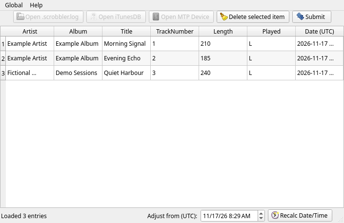

# QtScrobbler

Import your portable player's listening history, review the tracks, and scrobble them from a Qt desktop app or the command line.

[](https://github.com/marcelpetrick/QtScrobbler/actions/workflows/ci.yml)
[](https://github.com/marcelpetrick/QtScrobbler/actions/workflows/release.yml)
[](https://github.com/marcelpetrick/QtScrobbler/releases)
[](LICENSE)
[](documents/DEPENDENCIES.md)
[](documents/DEPENDENCIES.md)
[](CMakeLists.txt)
[](documents/GITHUB_ACTIONS.md)
[](documents/QUALITY.md#measured-results)
[](documents/QUALITY.md#measured-results)
[-brightgreen.svg)](documents/MUTATION_TESTING.md#measured-results)
[](tests/CMakeLists.txt)
[](.clang-format)



## Your listening history, ready to review

- Import Audioscrobbler logs, iPod databases, and supported MTP players.
- Review and edit track details, remove entries, and recalculate timestamps before submitting.
- Configure scrobbling services in the desktop settings, or use the CLI for scripted workflows.
- Use the English, German, or Polish interface.

Linux is the fully qualified platform. Each CI run also builds a Windows x86-64 package
with Qt 6.12.1 (MinGW) and gates it on all eleven Qt Test suites and a smoke test of
the extracted ZIP; MTP support is Linux-only. macOS sources are retained but not built.

The screenshot comes from the running application after importing the
[fictional example log](examples/README.md). Recreate it with
`tools/capture_screenshot.sh /path/to/build`; the capture uses temporary settings and a log copy.

The complete local 0.15.11 gate covered 2,725 of 2,752 lines (99.02%) and
1,037 of 1,073 branches (96.64%). Test assertions killed 1,390 of 1,734
native mutants (80.16%, Mull 0.39.1), meeting the 80% goal. [Measured results](documents/QUALITY.md#measured-results)

[Build and dependencies](documents/DEPENDENCIES.md) ·
[Testing and quality](documents/QUALITY.md) ·
[Acceptance and E2E](documents/ACCEPTANCE.md) ·
[Architecture](documents/ARCHITECTURE.md) ·
[All documentation](documents/README.md) ·
[Report an issue](https://github.com/marcelpetrick/QtScrobbler/issues)

## Download

Published x86-64 builds come with notes listing the changes and checks that
passed. [GitHub releases](https://github.com/marcelpetrick/QtScrobbler/releases)

- `QtScrobbler-<version>-x86_64.AppImage`: self-contained, bundles Qt 6.12.
  Run `chmod +x QtScrobbler-*.AppImage && ./QtScrobbler-*.AppImage`.
- `qtscrobbler-<version>-linux-x86_64.tar.gz`: the stripped `qtscrob` (GUI) and
  `scrobbler` (CLI); needs Qt >= 6.12 and libmtp installed.
- `qtscrobbler-<version>-windows-x86_64.zip` (Windows 10/11): unpack and run
  `qtscrob.exe` (GUI) or `scrobbler.exe` (CLI); bundles Qt 6.12 and the MinGW runtime.

Verify a download with its `.sha256` file: `sha256sum -c <file>.sha256`.

## Requirements

- Qt >= 6.12 (qualified build: Qt 6.12.1)
- CMake >= 3.28
- A C++23 compiler (qualified native toolchain: Clang 20.1.8)
- `cmake`, `pkg-config`, libmtp and exactly zlib 1.4

Use private Qt SDK and zlib prefixes; distribution packages may be below these
versions. See the tested setup in the [dependency inventory](documents/DEPENDENCIES.md).

---

## How to build

### Run the local pipeline

```sh
python3 tools/install_cmake.py --prefix /path/to/cmake
python3 tools/install_aux_tools.py --prefix /path/to/aux-tools
export PATH=/path/to/cmake/bin:/path/to/aux-tools/bin:$PATH
python3 tools/install_mutation_toolchain.py --prefix /path/to/native-tools
python3 tools/install_mull_callfix.py --toolchain-prefix /path/to/native-tools --prefix /path/to/mull-callfix
. /path/to/mull-callfix/env.sh
python3 tools/install_zlib.py --prefix /path/to/zlib
export ZLIB_ROOT=/path/to/zlib
export QTSCROBBLER_QT_PREFIX=/path/to/Qt/6.12.1/gcc_64
QTSCROBBLER_JOBS=4 ./localPipeline.sh --noRun --noOpen --report-dir /tmp/qtscrobbler-reports
```

Install the locked Python tools and native analyzers described in the
[dependency inventory](documents/DEPENDENCIES.md) and put them on PATH first.
The default pipeline runs builds, translations, offline Qt Test/CTest, formatting,
static analysis, fatal Doxygen/docs checks, isolated ASan/UBSan, LLVM coverage,
native Mull mutation and extracted-package CLI/GUI checks. Missing tools, failed
checks and scores below the configured quality thresholds fail the complete gate.
The qualification requirements are 99% line coverage and 95% branch coverage.
The native mutation policy sets a 65% floor; `MUTATION_MINIMUM` in
`localPipeline.sh` enforces the 80% mutation goal as its ratchet.
Retained reports include actual statuses and tool versions.

`--quick` explicitly runs only the build/test diagnostic subset. `--baseline` runs
all stages while recording incomplete coverage/mutation as measurements; it does
not qualify a release. Current measured progress and open requirements are in
[plan.md](documents/plan.md). See [quality commands](documents/QUALITY.md),
[architecture](documents/ARCHITECTURE.md) and [API contracts](documents/API.md).

A [fictional example log](examples/README.md) is provided for safe imports from a temporary copy.

### Full build (out-of-tree, all targets)

```sh
cmake -B build -S . -DCMAKE_BUILD_TYPE=Release \
  -DCMAKE_PREFIX_PATH=/path/to/Qt/6.12.1/gcc_64 -DZLIB_ROOT=/path/to/zlib
cmake --build build --parallel 4
ctest --test-dir build --output-on-failure --no-tests=error
```

Binaries are written to `build/` (GUI: `build/qtscrob`, CLI: `build/scrobbler`).

---

## Acceptance and end-to-end tests

The suite includes a real CLI import/upload process against a loopback service,
GUI import/edit/settings/submit/cancel acceptance workflows, and the actual GUI
process starting and closing on a private Xvfb display. All use disposable data.

```sh
ctest --test-dir build --label-regex acceptance --output-on-failure --no-tests=error
ctest --test-dir build --label-regex e2e --output-on-failure --no-tests=error
```

See the [scenario and evidence map](documents/ACCEPTANCE.md) for the exact checks,
packaged-app smoke commands, and the distinction between widget integration,
process end-to-end tests, and unperformed physical-device/live-service checks.

## How to run

### GUI

```sh
./build/qtscrob
# Optional flags:
#   -c PATH   path to configuration file
#   -v LEVEL  verbosity (0=error … 3=trace)
```

### CLI

```sh
./build/scrobbler --help
# Select a player directory and configure a service before submitting tracks.
# Use the fictional example only from a disposable copy; see examples/README.md.
```

---

## Project and contributors

QtScrobbler is an independent fork of the original SourceForge project by Tomasz
Mon, Robert Keevil, and other contributors. Marcel Petrick maintains the Linux
port, which moved first to Qt 5 and then to Qt 6.12. It remains licensed under
[GPLv2](LICENSE). See [contributors](documents/AUTHORS),
[changes](documents/CHANGELOG), and the [Qt port history](documents/port_to_qt6.md).

Ideas and bug reports are welcome through [GitHub issues](https://github.com/marcelpetrick/QtScrobbler/issues).
