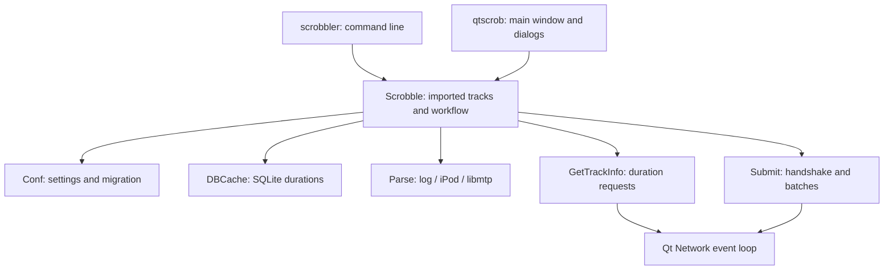

# Architecture and ownership

QtScrobbler builds a shared implementation as the static `scrobble` library. The
`scrobbler` command line and `scrobble_gui` widget library call that implementation;
`qtscrob` provides the graphical entry point. Tests link the same production targets.
There is no alternative test implementation of parsing, submission or UI behavior.

`Scrobble` owns its parser, configuration, cache and metadata helper. It creates one
submission object per enabled site. Parsing emits track values and an explicit
success/failure completion; the orchestrator forwards completion to both frontends.
Track submission state is kept separately for each configured site. Failed and
cancelled requests do not justify clearing the source history.

Log parsing consumes Audioscrobbler records. iPod parsing validates binary bounds
and uses bounded zlib decompression. The Linux MTP adapter defaults to real libmtp
operations, while its backend seam lets tests simulate discovery, listing, metadata
updates and cleanup. Windows-only adapter code is not compiled or measured on Linux.

The SQLite cache uses a unique connection per object and releases queries before
removing its connection. Injected storage paths and clocks make expiry tests
independent of the user's database and wall clock. Settings migrations preserve
the source until destination synchronization succeeds.

Metadata and submission use Qt's event loop and owned network replies. The metadata
helper retains a QThread-compatible public type; network requests execute with the
manager's QObject affinity. Delayed work uses cancellable generations rather than
sleeping inside an event callback. Destruction cancels requests and joins the worker.

GUI dialogs must not destroy a network manager from a nested modal event loop while
its finished callback is still unwinding. Submission completion and cancellation
transitions are queued before presenting modal messages or disposing progress UI.
The command line waits for duration lookup before choosing tracks for submission.

## Validation boundaries

Default tests replace HOME/XDG settings before creating their Qt application, use
fixture copies and temporary databases, and restrict HTTP collaborators to loopback
or injected replies. Real devices and live scrobbling services are not required or
claimed by simulated tests. Tests use bounded Qt event loops and join/release workers,
network replies and SQL connections.

Normal, coverage, sanitizer and mutation builds have separate directories. LLVM
coverage reports explicit source branch regions; implicit exception edges are not
source branches. Complete production file inventories prevent missing MTP or GUI
code from silently reducing scope. Mutation reports retain survivors, uncovered
mutants, crashes, timeouts and infrastructure errors separately.

See [API contracts](API.md), [quality commands](QUALITY.md), [dependencies](DEPENDENCIES.md)
and [the execution plan](plan.md) for measured evidence and remaining requirements.
